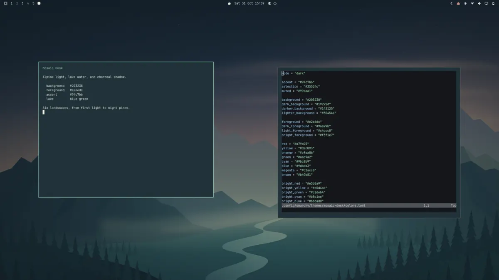

# Mosaic Dusk

An Omarchy theme drawn from the [Mosaic](https://github.com/naolselemon/mosaic) artwork: deep slate and evergreen, muted sea-glass accents, and warm light at the edge of night.



Install from this repository and cycle through its six backgrounds:

```sh
omarchy theme install https://github.com/naolselemon/omarchy-mosaic-dusk-theme.git
omarchy theme bg next
```

The starting background, **Mosaic Midpoint**, is joined by five companion scenes (WebP/PNG wallpapers in `backgrounds/`, editable SVG artwork in `artwork/`):

- **First Light** — dawn breaking through a mountain pass over still water.
- **Cascades** — water finding its way through fractured stone.
- **Stillpoint** — a mountain held in the reflection of a quiet tarn.
- **Cloud Sea** — ridges rising above a basin of mist.
- **Night Pines** — moonlight falling across the water and dark firs.

## GTK file managers and apps

`colors.toml` themes Omarchy's supported apps; `icons.theme` gives Nautilus and other GNOME apps sage-colored icons. Omarchy itself sets only dark mode and icons for GTK, so its default Adwaita surfaces and accent otherwise stay gray and blue. For matching GTK3/GTK4 backgrounds and a teal accent, opt into the bundled, reversible theme-change hook:

```sh
omarchy hook install theme-set "$HOME/.config/omarchy/themes/mosaic-dusk/integrations/gtk-sync"
omarchy theme set mosaic-dusk
```

The hook copies the palette into GTK's user stylesheet **only while Mosaic Dusk is selected**, preserves other user CSS, and restores the previous GNOME accent when switching away. Reopen running GTK apps (including Nautilus) to pick up the stylesheet. This integration is opt-in because themes installed from a repository must not execute arbitrary code; unrelated apps that do not use Omarchy palettes or GTK require their own theme support.

The preserved [original Mosaic wallpaper source](https://github.com/naolselemon/mosaic/blob/main/assets/showcase-wallpaper.svg) lives in the Mosaic repository rather than being duplicated here. Artwork and theme © 2026 Naol Selemon; licensed under the MIT License (see [LICENSE](LICENSE)).
